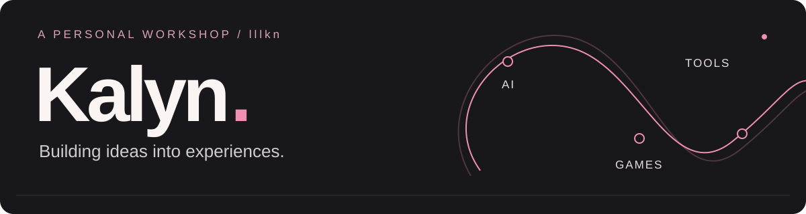

  

# Hi, I'm Kalyn · 鲁凯宁

**把 AI 想法做成可体验的作品，把制作经验留下来。**  
*I build AI applications, playful experiences, and tools that make the next idea easier to ship.*

西安交通大学 · 计算机科学与技术本科（2024–2028）。我喜欢从一个具体的问题或感受出发，做产品、写代码、设计交互，再把好用的方法整理成 Skill 和工作流。

[个人网站 ↗](https://lllkn.github.io/kalyn-site/) · [小游戏试玩 ↗](https://lllkn.github.io/casual-game-arcade/) · [Web Taste ↗](https://github.com/lllkn/web-taste) · [English introduction](#a-little-more-in-english)

## 我在做什么

- **AI 与工作流**：让 Agent 学会可复用的方法；也在量化研究实践中探索因子挖掘、策略回测与智能体投研链路。
- **游戏与互动**：从本草文化、AI NPC 到休闲小游戏，关心玩法、叙事和实际操作的感受。
- **有温度的产品**：探索陪伴、记忆、情绪声景和模拟购物，思考技术怎样回应人的日常需要。
- **研究与验证**：参与自适应学习与区块链跨链安全研究，关注生成结果如何被约束、检查和验证。

## 从这些作品认识我

| 作品 | 做了什么 · 值得看什么 | 入口 |
| :--- | :--- | :--- |
| **Web Taste** Agent Skill · 设计工具 | 从参考网站学习可迁移的设计规律，以视觉证据供人审阅，把确认后的判断沉淀为审美记忆，再用于新界面。适配 Codex、Claude Code、Cursor 与 GitHub Copilot。 | [源码与案例](https://github.com/lllkn/web-taste) |
| **百草行 · Baicaoxing** 文化游戏 · AI 互动 | 把本草知识、探索与问诊组织成可玩的体验；项目获得**腾讯云游戏黑客松全球三等奖**。公开仓库保留一个 Web 版本。 | [试玩](https://baicaoxing12.netlify.app/) · [源码](https://github.com/lllkn/herb) |
| **空闲一下 · Little Playground** 休闲游戏作品集 | 7 款浏览器小游戏：**箭头小铺、箭头连接为个人原创与策划作品**；其余 5 款为经典复刻 / 实习 Demo。提供玩法说明、重玩、全屏和单款分享。 | [试玩](https://lllkn.github.io/casual-game-arcade/) · [源码](https://github.com/lllkn/casual-game-arcade) |
| **Vibe O! / Vibe Order** 产品实验 · 模拟购物 | 从“想买”与“需要”的距离出发，用虚拟余额保留选择的代价，让购物仪式与消费后的回看成为体验的一部分。 | [体验](https://lllkn.github.io/vibeo/) · [部署仓库](https://github.com/lllkn/vibeo) |
| **栖声 · Qisheng** 情绪声景 · Web Audio | 输入一句心情，编排雨、风、流水等声音。以本地规则解析情绪，结合程序合成与按需加载的录音，支持混音、定时与配方收藏。 | [体验](https://qisheng.vercel.app/) · [源码](https://github.com/lllkn/qisheng) |
| **知识追踪测试框架** Python · 学习系统基础设施 | 统一预处理、模型接口和预测输出，支持 ASSISTments / EdNet 转换与自动检查。默认使用明确标记的模拟数据和 Mock 模型，真实模型通过插件接入。 | [源码与验证记录](https://github.com/lllkn/knowledge-tracing-test) |

## 继续探索

**山河信使** — 2026 年 10 月使用 Godot 独立开发的 3D 探索游戏，与学校民族研究学院、软件学院合作；包含 5 张 3D 地图与多个 AI NPC 互动小游戏。

**Momo** — HarmonyOS AI 陪伴应用，探索生活记录、连续陪伴与记忆的可视化表达。

**KnowPath · 知路** — 自适应学习系统，把知识图谱约束、认知诊断、LLM 路径生成与后验校验连接起来。

**跨链安全研究** — 学生第一作者，参与信誉机制、动态成员下的密钥更新、形式化建模与实验；论文目前在投。

## 一些积累

- **腾讯云游戏黑客松全球三等奖** · 百草行
- **全国大学生数学建模竞赛省一等奖** · 2025、2026
- **正大杯省一等奖** · **国家励志奖学金**
- **互动广告制作实践** · HTML5 试玩内容、跨角色协作、Prompt 模板与制作 SOP

## 常用工具与方法

| 方向 | 常用技术与工具 |
| :--- | :--- |
| 开发 | Python · JavaScript / TypeScript · C / C++ · Git · Linux |
| AI 应用 | LLM API · Agent 工作流 · RAG · Prompt Engineering · Skill 编写 |
| 交互与产品 | HTML / CSS · Web Audio · Godot · Phaser · HarmonyOS / ArkTS |
| 研究与数据 | PyTorch · 知识追踪 · 策略回测 · LaTeX |

我习惯这样推进一个想法：**找到问题 → 拆出结构 → 做出可体验版本 → 检查与打磨 → 留下可复用的方法。**

<strong>A little more in English</strong>

I'm Kalyn (Kaining Lu), a Computer Science undergraduate at Xi'an Jiaotong University, class of 2028. My work connects AI applications, interactive games, product thinking, and research.

I build things people can try, from an Agent Skill that learns design taste to cultural games, ambient soundscapes, and a shopping simulator. I also explore adaptive learning, cross-chain security, and Agent workflows for quantitative research.

Start with **[Web Taste](https://github.com/lllkn/web-taste)** for my approach to reusable tools, or visit **[Little Playground](https://lllkn.github.io/casual-game-arcade/)** to try the games. My cross-chain security paper is currently under review.

---

代码之外，也喜欢写作、旅行、手工，以及记录生活里细小的感受。欢迎围绕 AI 工具、游戏体验和有意思的产品交流；更多作品与联系方式见[个人网站](https://lllkn.github.io/kalyn-site/)。

> 个人进步是解决所有问题的最优解。
